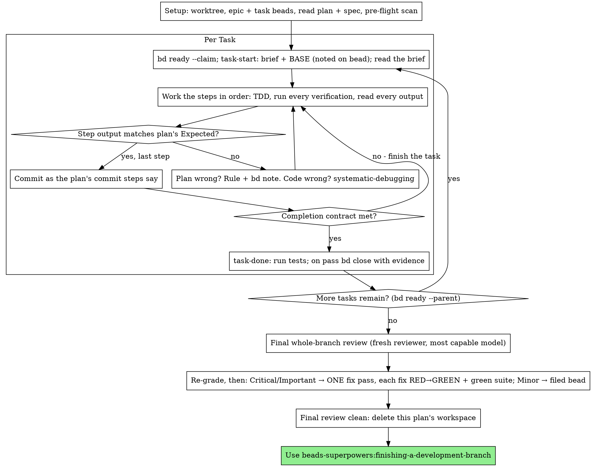

# Executing Plans

Execute the plan yourself, task by task, in this session: no implementer
subagent per task, no reviewer per task. One fresh-context review of the
whole branch at the end.

**Announce at start:** "I'm using the executing-plans skill to implement this plan."

**Why inline:** Subagent-driven development pays for a fresh implementer
and a fresh reviewer on every task, each re-reading the codebase from zero.
Native execution pays for one context (yours) plus one reviewer at the end.
What it gives up is a fresh context per task and a second pair of eyes per
task. This skill keeps what those two things bought, by other means: the
brief is the spec, beads is your memory, TDD is the per-task gate, and the
final reviewer is the second pair of eyes.

**Core principle:** The plan already did the thinking. Execute it exactly,
prove each step with a test you watched fail and then pass, and leave a
record in beads that survives your own forgetting.

**Narration:** between tool calls, narrate at most one short line — the
beads record and the tool results carry the rest.

**Continuous execution:** Do not pause to check in with your human partner
between tasks. They chose Native execution to spend less, not to answer
"should I continue?" after every task. Execute all tasks from the plan
without stopping.

**Rulings, not stalls.** Plan defects and ambiguities the spec settles —
decide them. The spec is the binding authority, the plan is its argument,
and your judgment settles what neither answers. Record every decision on
the epic bead — the same place subagent-driven-development keeps its
rulings, so either executor can pick up the other's — as
`bd note <epic-id> "Task <N>: Ruling: <what you decided> — <why> — cost if wrong: <…>"`,
and keep going. Deviating from the plan without a recorded ruling is a
decision made in secret.

**Production-Grade Doctrine:** a ruling may change *how* a requirement is met, never *whether* — dropping or shrinking a spec requirement is the user's call, not a ruling. Never weaken, bypass, or remove a security control — a security regression is never acceptable.

These stop you, and only these: an irreversible or destructive operation;
a security-sensitive action; a side effect outside this worktree that
norms say you ask about first (a merge, a push to a shared branch, a
publish); a change that would cut or weaken a spec requirement; and a plan
so broken that every path forward is a guess. For those, stop and ask (see
**Blockers** below).

## When to Use

- You have a plan from beads-superpowers:writing-plans and your human
  partner chose Native execution at the handoff.
- Your harness has no subagent tool (see the per-platform references in
  `../using-superpowers/references/`). Never fabricate a dispatch; run the
  plan here.
- Tasks are mostly independent — the same precondition as
  beads-superpowers:subagent-driven-development.

A fully specified plan makes Native execution transcription plus testing:
it runs well on a mid-tier session model, and the one place the most
capable model earns its cost is the final review, which this skill
dispatches separately. Tell your human partner so when they choose Native.

Prefer beads-superpowers:subagent-driven-development when your human
partner wants a review gate on every task, or when the plan is long enough
that its later tasks would run on a compacted context. Native execution
over a long plan still works — beads is what makes it recoverable — but
the last tasks get the least of you.

## The Process



## Setup

Ensure the work happens in an isolated workspace: use
beads-superpowers:using-git-worktrees to create one or verify the existing
one. Never start implementation on a main/master branch without your human
partner's explicit consent.

Read the plan once and note its context, Global Constraints and Review
Focus. If the plan names a `Spec:`, read that too: the spec is the
authority the plan argues from, and conflicts inside the plan resolve
against it. A plan with no reachable spec gets a note on the epic saying
so — rulings made without one are provisional.

### Beads is the ledger

Conversation memory does not survive compaction. An inline executor that
loses its place re-implements tasks whose commits already exist. **Beads
is your durable ledger** — it survives compaction and is reloaded by the
session hook's composed beads context (or `bd prime`). Do **not** keep a
markdown progress file or harness todos alongside it.

- **Resuming?** If an epic for this plan already exists, run
  `bd ready --parent <epic-id>` and `bd list --parent <epic-id> --status all`:
  closed task beads are DONE — do not redo them; their commits exist in git
  even when your context no longer remembers making them. An
  `in_progress` bead's notes carry its `task-start` BASE. Trust beads and
  `git log` over your own recollection.
- **Fresh start:** create the epic, then import the child tasks as JSONL:

   ```bash
   # 1. Create the epic (→ note its id):
   bd create "Epic: <plan-name>" -t epic -p 2 -d "<goal>

## Success Criteria
- <measurable outcome from the plan's Goal>"

   # 2. Author the tasks as JSONL — one issue per line, id OMITTED (auto-assigned;
   #    a supplied colliding id would overwrite that bead and reset its omitted fields).
   #    Parent each to the epic; embed the bd lint-required '## Acceptance Criteria' in
   #    'description' (or the 'acceptance_criteria' field). Read `bd import --help` on
   #    first use; `bd export <id>` round-trips a real bead as a schema template.
   cat <<'EOF' | bd import -
{"title":"Task 1: <title>","issue_type":"task","priority":2,"description":"<summary>\n\n## Acceptance Criteria\n- <outcome>","dependencies":[{"depends_on_id":"<epic-id>","type":"parent-child"}]}
{"title":"Task 2: <title>","issue_type":"task","priority":2,"description":"<summary>\n\n## Acceptance Criteria\n- <outcome>","dependencies":[{"depends_on_id":"<epic-id>","type":"parent-child"}]}
EOF
   ```

   Confirm the import output shows no `Skipped dependency` (a dep to a missing target is skipped, not rolled back). `bd lint` requires `## Success Criteria` in the epic's description and `## Acceptance Criteria` in each task's — embed them as above. Keep the `Task N:` title prefix: it is how a bead maps back to its plan task.

   > **Wire task ordering (`blocks`) after the import.** `parent-child` rides the import, but inter-task `blocks` deps do not (children's ids are auto-assigned, so siblings can't reference each other in one file). Capture the ids **scoped to the parent** (a title grep collides with old beads), then wire ordering atomically:
   > ```bash
   > bd ready --parent <epic-id> --json   # → the child task ids
   > printf 'dep add <task-2-id> <task-1-id> blocks\n' | bd batch
   > ```
   > Note: `bd batch create` does not support `--description`/`--parent`/`--acceptance` — that is why task *creation* uses `bd import`, not `bd batch`.

### Workspace

Briefs, test logs and review packages are scratch, shared with
beads-superpowers:subagent-driven-development so a plan can change
executors mid-flight: `bash ../subagent-driven-development/scripts/sdd-workspace PLAN_FILE`
prints the plan's self-ignored directory (`.internal/sdd/<plan-basename>/`).
Another plan's directory is never yours to read or write. `git clean -fdx`
destroys it; nothing in it is the record — beads and git are.

**REQUIRED SUB-SKILL:** load beads-superpowers:test-driven-development
now, before Task 1. It governs every step of every task below; a plan
whose steps already say "write the failing test first" does not exempt
you from reading it.

### Pre-flight scan

Before Task 1, scan the plan for conflicts between tasks. The plan's
Interfaces blocks tell you where to look: for every task that consumes
what an earlier task produces, one row — the two tasks, what one produces
against what the other consumes, and what you found. Tasks that share
nothing get no row; a plan whose tasks share nothing gets the single row
`Pre-flight: no shared interfaces`. Record the rows on the epic in one
call (`bd note <epic-id> --file <rows>`). Rule on each conflict with the
spec as the binding authority and record the ruling beside its row.
Conflicts in a stop class above go to your human partner as **one batched
structured question** — each beside the plan text that mandates it —
before Task 1, not one interrupt per discovery mid-plan.

## The Task Loop

Everything you print, and every tool result, stays resident in your
context for the rest of the session. Redirect long test output to a file
in the workspace and read its tail; read a brief, not the whole plan.

### 1. Take the task

1. Get and claim the next task in one call: `bd ready --parent <epic-id> --claim` (use `bd ready --explain` to see dependency reasoning if task ordering is unclear).
2. Run `bash scripts/task-start PLAN_FILE N <task-id>` (this skill's `scripts/`; N from the bead's `Task N:` title). It prints the brief path and BASE — the commit the task's range is cut from — and notes BASE on the bead. Read the brief for every task, including ones you remember from setup: what you remember is a summary, the brief has the exact values, signatures, and test cases.
3. **Check description quality:** if the claimed bead and its brief are a bare title with no actionable steps, STOP — the task is claimed, so flag it (`bd label add <task-id> human`) so it doesn't dangle in-progress, and surface what is missing.

> **`--claim` consent boundary.** This skill's autonomous take-next / batch-dispatch flow is the one place `bd ready --claim` is legitimate. That autonomous `--claim` is FORBIDDEN wherever the user picks the work (orientation, brainstorming, session close) — the consent gate binds even when this skill is not loaded.

Every tool call is a turn that re-reads your whole context. Bookkeeping
rides along with work — a `bd note` in the same call as the commit, never
in a call of its own.

### 2. Work the steps

The plan's steps are already in RED-GREEN order; follow them in that order
under beads-superpowers:test-driven-development. A test step's code is
written first and run first. Watching it fail is a step, not a formality —
a test that passes before the implementation exists is a finding about the
test.

Every step that runs a command has an `Expected:` line. Run the command,
read its output, and compare. Three outcomes:

- **Matches.** Next step.
- **The code is wrong.** Use beads-superpowers:systematic-debugging. Find
  the cause; never patch the symptom to make the step's output match.
- **The plan is wrong** — a step contradicts the spec, an interface from an
  earlier task doesn't match what this task consumes, a command that
  cannot work. Rule on the smallest change that satisfies the spec, record
  it (`bd note <epic-id> "Task <N>: Ruling: <finding> — <what you decided and why> — cost if wrong: <…>"`),
  and continue. The ruling is carried, not remembered: later tasks that
  touch the same interface read it from the epic.

Commit as the plan's commit steps say. A task that spans several commits
is fine; BASE is what the review range is cut from, never `HEAD~1`.

### 3. The completion contract

Before a task closes, all of the following are true, with evidence in this
session — not inferred from the diff looking right:

- Every test the brief names exists and ran in this task, and you read
  the output.
- The final test run for the task passed — `task-done` is that run, and it
  writes the command and result into the close reason.
- Every `Expected:` line in the brief was compared against real output.
- Every deviation from the brief has a `Ruling:` note on the epic.

**REQUIRED SUB-SKILL:** beads-superpowers:verification-before-completion
governs the claim. If any item is missing, the task is not complete:
finish it.

### 4. Complete the task

Run `bash scripts/task-done PLAN_FILE N <task-id> BASE -- <test command>`
with the project's test command the brief names for the whole task. It
runs the tests, keeps the full output in the workspace, prints the tail,
and — only if they pass — closes the bead with the evidence:

`Completed: commits <base7>..<head7>, tests: <command> → <last output line>`

A failing run closes nothing; the task is not complete. A passing command
that prints nothing records `→ (no output)`. Check `bd epic status <epic-id>`
when you want the overall picture, then take the next task.

### Blockers

When one of the stops above hits, classify it and act:

| Blocker type | Action | Command |
|---|---|---|
| **Time-based** (waiting on deploy, external process) | Defer the task for later | `bd defer <task-id> --until="<date>"` |
| **Missing work** (prerequisite not built yet) | Create the missing task and wire dependency | `bd create "Missing: <title>" -t task --parent <epic-id>` then `bd dep add <blocked-id> <new-id>` |
| **Human decision needed** (cut/weaken a requirement, destructive or security-sensitive step, unguessable plan) | Flag for human input and ask | `bd label add <task-id> human` |

> **Discovered-work bead stamp:** `bd create "[spec] <title>" -t task --parent <epic-id> --notes "Severity:/Confidence:/Evidence:"` — see `verification-before-completion` → Agent-Filed Bead Discipline.

## Final Review

Run `bash ../subagent-driven-development/scripts/review-package PLAN_FILE MERGE_BASE HEAD`
(MERGE_BASE = the commit the branch started from, e.g.
`git merge-base main HEAD`) and review from the file it prints.

**With a subagent tool:** dispatch the reviewer on the most capable
available model — the whole-branch review is a judgment task — using
beads-superpowers:requesting-code-review's
[code-reviewer.md](../requesting-code-review/code-reviewer.md), with the
package path, the plan and spec paths, the plan's Review Focus section
verbatim if it has one (the input classes and failure modes the plan's
tests do not exercise — the reviewer checks each deliberately), and the
epic's `Ruling:` notes so it can weigh the calls
you made. Specify the model explicitly; an omitted model inherits the
session's, which may not be the most capable. This is the one fresh
context the whole run buys. Do not skip it, and do not replace it with
your own read of the diff.

**Without a subagent tool:** read code-reviewer.md and perform that review
yourself against the package, as a separate pass after the last task
closes. Note `Final review: self-review (no subagent tool)` on the epic,
and say so in your final message: a self-review by the author is weaker
than a fresh reviewer, and your human partner decides whether that is
enough before merge.

Sort the findings before you act on any of them. The reviewer's severity
labels are advice; re-grade first, by effect: the spec is a vision
document, and a finding's grade is what a reasonable person using this
software gets if it ships, not whether the spec names the input that
triggers it. Re-grading may raise a severity, never lower a security
finding. Its "Declined to judge" list is yours too: each line is a ruling
you make and note on the epic, exactly like a plan conflict. Then:

- **Critical and Important** enter the fix pass.
- **Minor** is filed as a bead, never silently dropped:
  `bd create "[review] <one-liner>" -t task --parent <epic-id> --notes "Severity: minor/Confidence:/Evidence:"`,
  and listed in your final message under "Deferred minors". Minors never
  enter the fix pass, and never become rulings.

Fix the Critical and Important findings yourself — you are the
implementer here — in ONE pass. Each fix is verified by TDD, not by a
second reviewer: write the test that reproduces the finding, watch it
fail, make it pass, then run the whole suite. Note each on the epic:
`Final: fixed <finding> — <test name> RED→GREEN, suite <N>/<N>`. A fix
without a test that failed first is not verified; a suite that is not
green after the pass means the pass is not over. Do not dispatch a
re-review: the covering tests answer "addressed" and the green suite
answers "broke nothing".

A Critical or Important finding you believe should not be fixed is not
yours to waive: file it as a bead labelled `human` with your reasoning and
surface it — your human partner decides. A security finding is never
declined. There is no second fix pass.

## Finish

Before you delete anything, collect every `Ruling:` note from the epic
(`bd show <epic-id>` — preflight, mid-plan and final rulings alike) into
your final message under "Rulings I made", in the order you made them, each with what it costs if wrong; every filed minor under "Deferred
minors"; and every `human`-labelled finding. These lists are exhaustive.
Your final message is where the decisions you took on your human
partner's behalf reach them.

When the final review is clean and its fixes are committed, delete this
plan's workspace directory — beads and git history are the record. Sibling
directories belong to other plans; leave them alone.

Announce: "I'm using the finishing-a-development-branch skill to complete this work."

**REQUIRED SUB-SKILL:** Use beads-superpowers:finishing-a-development-branch
— it includes the **Land the Plane** session close protocol
(`bd close` → `bd dolt push` → `git push` → `git status`).

## Red Flags

| Excuse | Reality |
|--------|---------|
| "I remember what Task N says" | You remember a summary. The brief has the exact values. Read it. |
| "The plan's code is right, skip watching the test fail" | A test you never saw fail proves nothing. It is one step. Run it. |
| "I'll run the full suite at the end instead of per step" | Per-step runs are how you learn which step broke it. The end-of-task run is the contract, not a substitute. |
| "The plan is wrong here, I'll just do the right thing" | Do the right thing and note the ruling on the epic. Unrecorded deviation is a decision made in secret. |
| "This requirement is awkward; a ruling can drop it" | A ruling changes how, never whether. Cutting a requirement is your partner's call — stop and ask. |
| "I'll close the beads after a few tasks" | Compaction does not wait for a convenient moment. `task-done` closes each task as it finishes. |
| "Let me check in before the next task" | They chose Native to spend less. Progress prompts spend their time instead. Only the listed stops stop you. |
| "I read my own diff carefully; the final reviewer is redundant" | Same author, same blind spots. The reviewer is the only fresh context this run buys. |
| "Tests should pass, the change was trivial" | "Should" is not evidence. The contract requires the command and its output. |
| "The reviewer said Minor, so it's Minor" | The label graded the spec's silence. Grade what the person gets. Re-grade, then gate. |
| "The fix is obvious, no need for a failing test first" | The failing test is the only proof the finding was real and is now gone. |
| "I'll fix the minors too while I'm in there" | Every minor you fix is work your partner did not ask for. File them; your partner decides. |

**Production-Grade Doctrine:** never skip a verification or drop a task to make progress — `bd defer`/`bd human` are for genuine blockers, never a quiet way to descope required work. Never weaken, bypass, or remove a security control — a security regression is never acceptable.

**Capture what you learned.** At close, record durable, evidence-backed insights (still true next month, tied to a file, test, or command). Never record guesses, one-offs, or secrets (tokens, keys, PII — every memory is injected into all future sessions). Update in place (`bd remember --key <key>`) rather than adding a near-duplicate.

```bash
bd remember "<kind>: <durable, evidence-backed insight>"   # kind: lesson / pattern / design / root-cause / research
```

## Example Workflow

```
You: I'm using the executing-plans skill to implement this plan.

[Worktree verified; plan read: .internal/plans/feature-plan.md; Spec: read]
[Epic bd-a1 created; Tasks 1-2 imported as bd-a1.1, bd-a1.2; ordering wired]
[Pre-flight: 1 shared-interface row, clean → bd note bd-a1]

Task 1: Hook installation script
[bd ready --parent bd-a1 --claim → bd-a1.1]
[bash scripts/task-start plan 1 bd-a1.1 → brief read; BASE a1b2c3d]
[Step 2: run failing test — FAIL: install_hook not defined. Matches Expected.]
[Steps 3-5: implement, PASS 1/1, commit d4e5f6a]
[bash scripts/task-done plan 1 bd-a1.1 a1b2c3d -- npm test
 → closed bd-a1.1: Completed: commits a1b2c3d..d4e5f6a, tests: npm test → 14/14 pass]

Task 2: Recovery modes
[claim bd-a1.2; task-start → BASE d4e5f6a]
[Step 2: FAIL on an import error: Task 1 produces installHook, brief consumes install_hook]
[bd note bd-a1 "Task 2: Ruling: install_hook → installHook — matches Task 1 Produces — cost if wrong: one rename"]
[Steps 3-5; commit b7c8d9e; task-done → closed bd-a1.2]

[review-package plan MERGE_BASE HEAD; code-reviewer dispatched on the most capable model]
Reviewer: One Important (progress interval hardcoded). One Minor.
[Minor → bd create "[review] README lacks usage example" --parent bd-a1 ...]
[Fix: test_progress_interval_configurable RED → GREEN; suite 15/15; commit; bd note bd-a1 "Final: fixed …"]

Rulings I made:
- Task 2: install_hook → installHook (cost if wrong: one rename)
Deferred minors:
- bd-a1.3 README lacks a usage example

[Delete this plan's workspace]
Using beads-superpowers:finishing-a-development-branch.
```
